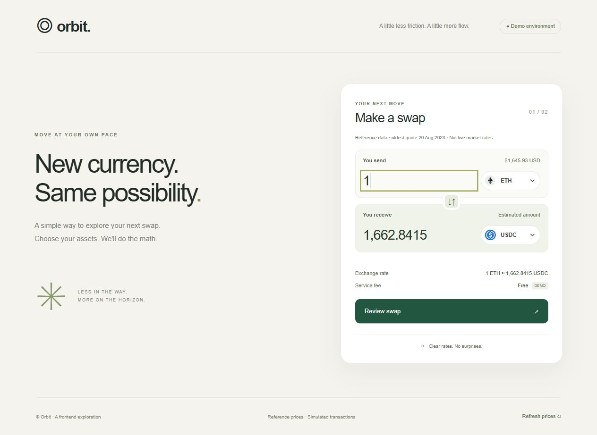

# 99Tech Frontend Code Challenge — Solutions

Completed the three problems listed in the Frontend tab of the challenge.

**Author:** Ha Ngoc Dung

**Live demo:** [Run all three problems](https://sntgames.com/frontend-challenge/) · [Open currency swap](https://sntgames.com/frontend-challenge/swap/)

The demo provides interactive results and source previews. This repository includes the complete source, tests, assumptions, and the issue analysis required for Problem 3. Problems 4 and 5 are outside the Frontend scope and are left unchanged.

| Problem | Solution | Notes |
| --- | --- | --- |
| 1: Three ways to sum to n | [JavaScript](src/problem1/solution.js) | [Approaches, complexity and assumptions](src/problem1/README.md) |
| 2: Fancy Form | [Currency swap](src/problem2/index.html) | [Features and running instructions](src/problem2/README.md) |
| 3: Messy React | [Refactored component](src/problem3/WalletPage.tsx) | [13 findings and explanations](src/problem3/README.md) |

## Run locally

Requires Node.js 22.18+ (or Node.js 24+) and npm. Node's built-in TypeScript stripping is used by the wallet tests.

```sh
npm ci
npm run dev
```

Open the URL printed by Vite. To validate:

```sh
npm test
npm run build
npm run preview
```

Tests cover all three sum implementations, safe-integer boundaries, price normalization, invalid quotes, stable wallet filtering/sorting and missing prices. The build type-checks the React refactor in strict mode and produces the swap app in `dist/`.

Browser verification: loaded the real price API, rejected a negative amount and identical currencies, converted ETH/USDC, reversed the pair, completed review/confirmation/loading/success/reset, and inspected the mobile layout at a 390px viewport with no horizontal overflow. API failure and timeout handling are implemented but were not fault-injected in the browser.



Sources: [challenge page](https://s5tech.notion.site/Code-Challenge-05cdb9e0d1ce432a843f763b5d5f7497), [skeleton repository](https://github.com/99techteam/code-challenge), [price data](https://interview.switcheo.com/prices.json), [token icons](https://github.com/Switcheo/token-icons/tree/main/tokens).

## Original submission instructions

Note that if you fork this repository, your responses may be publicly linked to this repo.  
Please submit your application along with the solutions attached or linked.   

It is important that you minimally attempt the problems, even if you do not arrive at a working solution.

## Submission ##
You can either provide a link to an online repository, attach the solution in your application, or whichever method you prefer.
We're cool as long as we can view your solution without any pain.
